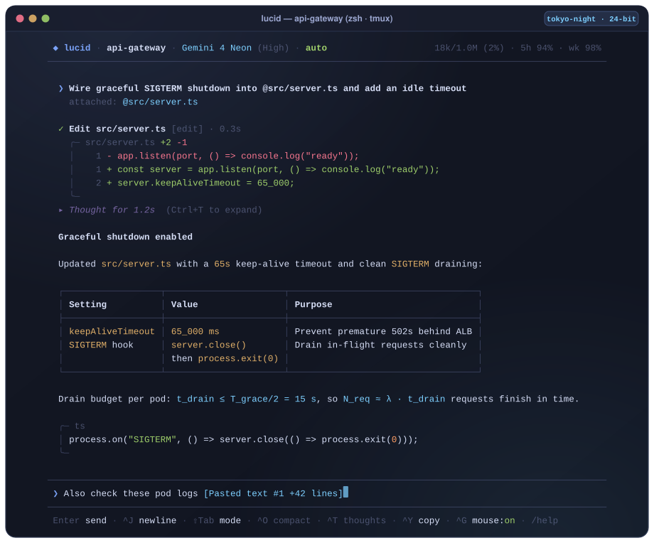
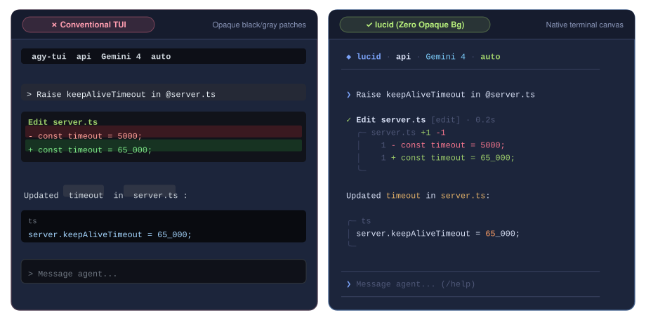
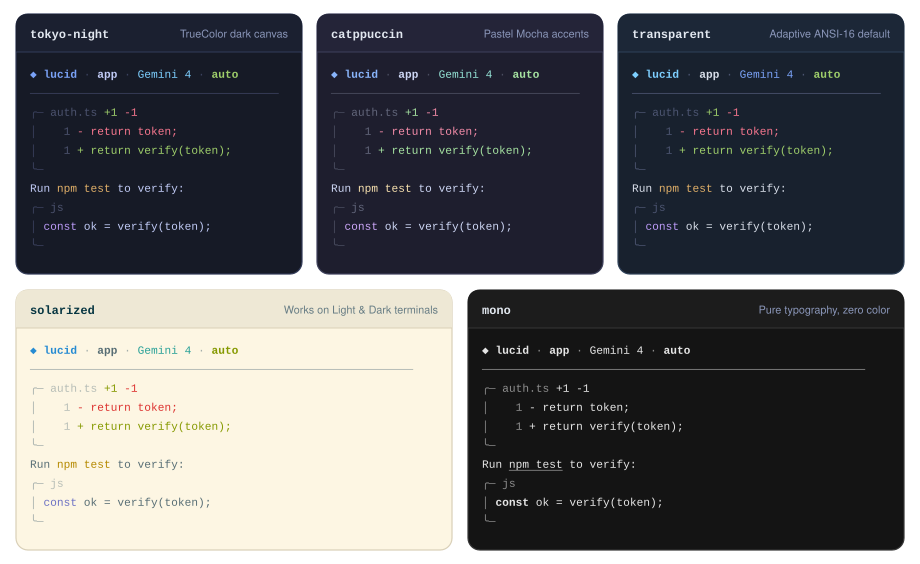
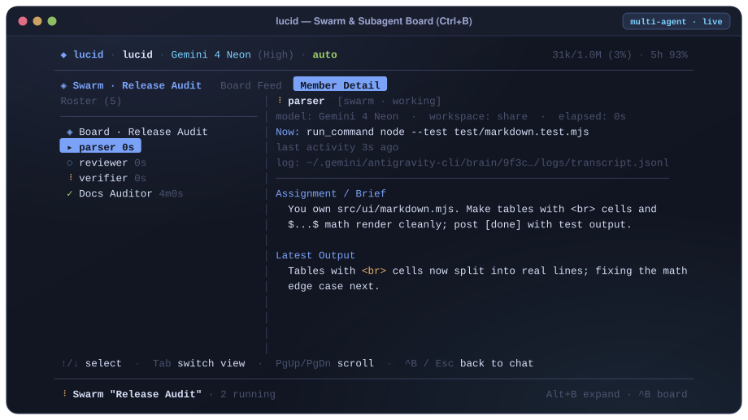
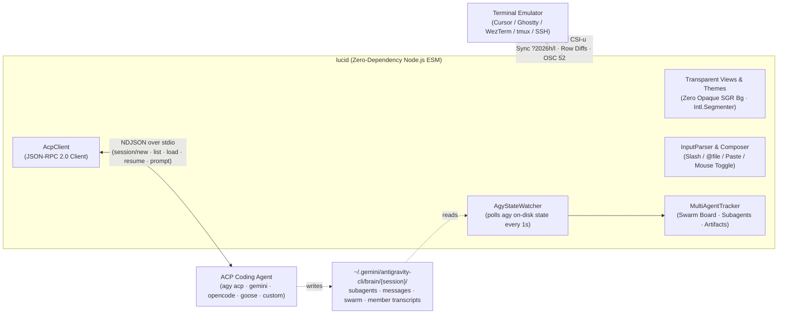

<p align="center">
  
</p>

<p align="center">
  = 20" />
  
  
  
  <a href="LICENSE"></a>
</p>

<p align="center">
  <strong>English</strong> · <a href="README.zh-CN.md">简体中文</a>
</p>

---

**lucid** is a transparent, flicker-free, zero-dependency Terminal User Interface (TUI) for **Google Antigravity (`agy acp`)** and any **Agent Client Protocol (ACP)** coding agent.

Most coding agent TUIs stamp opaque black or dark-gray rectangles behind messages, code blocks, diffs, and input boxes—clashing with custom terminal palettes, light themes, translucent windows, and `tmux` panes. **lucid** renders exclusively onto your terminal's native background (`\x1b[49m`), replacing heavy boxes with crisp typography, thin Unicode hairlines, and restrained foreground accents.

<p align="center">
  
</p>

---

## Why lucid?

<p align="center">
  
</p>

| Feature | What lucid does |
| :--- | :--- |
| **Zero Opaque Blocks** | Every surface—markdown, inline `code`, fenced code blocks, tables, diffs, modals, and the composer—leaves your terminal background untouched (enforced by automated tests across all 5 themes). |
| **Remote SSH + `tmux` Native** | DEC synchronized output (`?2026h`/`l`) + row-level differential rendering eliminate streaming flicker. Scrolling uses the terminal's hardware scroll region so only newly revealed rows travel over SSH (~90% fewer bytes per frame), and every row is sanitized before it is written, so heredocs, long commands and wrapped paths can never corrupt the screen. |
| **Select-to-Copy Mouse** | Drag over the conversation to select; it is copied on release via OSC 52 (with automatic `tmux` passthrough), and `Ctrl+C` copies the selection again. `Ctrl+Y` copies the latest reply; `Ctrl+G` switches to native terminal drag-select while the wheel keeps scrolling the conversation. |
| **First-Class Antigravity (`agy`)** | Connects to `agy acp --stdio`, reusing your Google login, models, thinking effort (`thought_level`), execution modes, saved history (`/resume` / `-r` / `-c`), inline permissions, and read-only `/quota`. |
| **Permission Modes on a Key** | Starts in `auto` mode; `Shift+Tab` switches into a session-only `bypass` that auto-approves every tool permission, and `--bypass` launches with everything approved. |
| **Live Multi-Agent Status** | A strip above the composer lists every Swarm worker / subagent by name with its state and current action; `Ctrl+B` (`/board`) opens the split-pane board with briefs, output and the shared message board. With agy, state is read from agy's live on-disk session data, so a background subagent finishing shows up as ✓. |
| **Math & Rich Markdown** | Inline and display LaTeX (`$...$`, `$$...$$`, `\(...\)`, `\[...\]`) renders as Unicode (subscripts, fractions, Greek, operators), `<br>` inside table cells becomes a real line break, and prices like `$5` are left alone. |
| **Collapsed Long Pastes** | Pastes over 4 lines or 300 characters become a `[Pasted text #1 +11 lines]` chip in the composer, removed with one `Backspace` and expanded to the full text on send. |
| **Zero Runtime Dependencies** | Pure Node.js (`>= 20`) ESM. Instant startup, grapheme-accurate CJK/emoji widths, and linear-time wrapping so even very long replies stay fast. |

---

## Quick Start

### Requirements

- **Node.js `>= 20.0.0`**
- An installed ACP-compatible agent such as **Google Antigravity CLI (`agy`)**, **Gemini CLI**, **OpenCode**, **Goose**, **Claude Code (ACP)**, or **Codex (ACP)**.

### Install

```bash
git clone https://github.com/Kagura-0001/lucid.git
cd lucid

# Option A: Link globally via npm
npm link

# Option B: Symlink directly into ~/.local/bin
chmod +x ./bin/lucid.mjs
ln -sf "$(pwd)/bin/lucid.mjs" ~/.local/bin/lucid
```

### Launch

```bash
lucid                         # Start a fresh Antigravity session in cwd
lucid -r                      # Open interactive session picker for cwd
lucid -r <id-or-prefix>       # Resume a specific session by full ID or >=4-char prefix
lucid -c                      # Continue the most recent conversation in cwd
lucid --theme tokyo-night     # Use Tokyo Night foreground accents (transparent bg)
lucid --agent opencode        # Launch OpenCode ACP instead of agy
lucid --cmd "gemini --experimental-acp"
```

---

## 5 Built-in Transparent Themes

Switch themes on the fly with `/theme` or at launch via `--theme <name>` (saved automatically to `~/.config/lucid/config.json`). Every theme preserves your native dark, light, or translucent terminal background:

<p align="center">
  
</p>

| Theme | Palette Style | Best For |
| :--- | :--- | :--- |
| `transparent` *(default)* | Adaptive ANSI-16 foregrounds | Automatically inherits your terminal's own 16-color scheme |
| `tokyo-night` | Crisp blue/cyan/violet TrueColor | Dark and translucent developer terminals |
| `catppuccin` | Soft Catppuccin Mocha pastels | Warm dark terminal setups |
| `solarized` | Balanced Solarized accents | Both **Solarized Light** and **Solarized Dark** terminals |
| `mono` | Bold, dim, and underline only | Distraction-free, pure typographic terminals |

---

## Swarm Board, Artifacts & Multimodal Input

While **Swarm** workers or **Subagents** are running, a strip above the composer names each member with its state, and the active one shows what it is doing:

```text
⠋ Swarm "parser rewrite" 2 working 1 waiting · ⠋ parser run_command cargo test  ◌ verifier  ✓ Tmp Lister · ^B board
```

Press **`Ctrl+B`** (or run `/board`) for the split-pane view: the roster on the left; on the right the selected member's brief, current action (`Now:`), last activity time, latest output and transcript path, or the shared message board. Generated Markdown plans or reports are indexed automatically under `/artifacts`.

> ACP only carries the main conversation: `invoke_subagent` completes as soon as the subagent is launched, and nothing reports its progress or reply. With agy, lucid therefore polls the session state agy writes locally once a second (`subagents/`, `messages/`, `swarm/` and each member's transcript under `~/.gemini/antigravity-cli/brain/<session>/.system_generated/`); unchanged files cost almost nothing. Set `"agyDataDir"` in the config if agy's data lives elsewhere.

<p align="center">
  
</p>

**Context & Image Attachments:**
- **`@path`**: Fuzzy-search workspace files (respects `.gitignore` via `git ls-files`) and embed them as ACP `resource` context blocks.
- **`Ctrl+V` / `/image <path>` / `@screenshot.png` / Drag & Drop**: Stage local clipboard images or file paths (PNG, JPEG, WebP, GIF up to 20 MB) as ACP `image` blocks. Use `/unattach` to clear staged images.

---

## Permissions & Execution Modes

| How | Effect | Scope |
| :--- | :--- | :--- |
| Default | Switches the agent to its `auto` mode at start; a mode chosen via `Shift+Tab` / `/mode` is remembered in the config | Persistent |
| `Shift+Tab` to `bypass` (or `/mode bypass`) | Agent runs in `auto` mode and lucid approves every tool permission request, including a dialog already on screen; a red `bypass` badge appears in the header | This lucid session only, never saved; `Shift+Tab` again restores prompts |
| `lucid --bypass` (`--yolo` / `--dangerously-skip-permissions`) | Passes `--dangerously-skip-permissions` to `agy acp`, so agy itself approves everything | Whole process; cannot be turned off mid-session |
| Config `"dangerouslySkipPermissions": true` | Same as always launching with `--bypass` | Persistent |

> In bypass the agent can delete files and run any command without asking. The session-level bypass can only approve what agy asks about; an action agy refuses outright (e.g. sandbox rules) is not overridden.

---

## Mouse, Copy & Scrolling

- **Mouse capture on (default):** the wheel scrolls the conversation; drag to select text and it is copied on release (OSC 52). The selection is anchored to content, so scrolling or streaming output does not shift it. Hold `Shift` (iTerm2: `Option`) to use the terminal's own selection instead.
- **Mouse capture off (`Ctrl+G` / `--no-mouse`):** dragging is handled natively by the terminal with zero latency; lucid enables alternate-scroll mode so the wheel still scrolls the conversation. With an empty composer even a single `↑` / `↓` scrolls; use `Ctrl+P` / `Ctrl+N` for prompt history.
- **OSC 52 copy** needs terminal support: VS Code, Windows Terminal, kitty and WezTerm work out of the box; iTerm2 needs "Applications in terminal may access clipboard"; inside `tmux` set `set -g set-clipboard on`.
- In the VS Code terminal, trackpad scrolling waits until a full line of movement accumulates before sending a wheel event, so the first nudge feels slow; raising `terminal.integrated.mouseWheelScrollSensitivity` to 2–3 helps.

---

## Supported ACP Agents

| Preset (`-a`) | Agent | Underlying Command | Extra Notes |
| :--- | :--- | :--- | :--- |
| `agy` *(default)* / `antigravity` | **Google Antigravity** | `agy acp --stdio` | Supports `/quota`, `--sandbox`, `--add-dir`, `--dangerously-skip-permissions` |
| `gemini` | **Gemini CLI** | `gemini --experimental-acp` | Standard ACP session & prompt streaming |
| `opencode` | **OpenCode** | `opencode acp` | Standard ACP session & prompt streaming |
| `goose` | **Goose** | `goose acp` | Standard ACP session & prompt streaming |
| `claude` | **Claude Code (ACP)** | `claude-code-acp` | Standard ACP session & prompt streaming |
| `codex` | **Codex (ACP)** | `codex-acp` | Standard ACP session & prompt streaming |
| `--cmd "<command>"` | **Any custom ACP server** | Arbitrary command | Or define reusable presets in `~/.config/lucid/config.json` |

---

## Architecture



---

## CLI Reference

### Command-Line Options

| Flag | Description |
| :--- | :--- |
| `-r, --resume [id]` | Open interactive session picker, or resume by exact ID / `>=4`-char prefix (`--resume=<id>` also supported) |
| `-c, --continue` | Resume the most recent conversation in `--cwd` |
| `-s, --session <id>` | Resume a specific session ID (supports `>=4`-char unique prefix) |
| `-a, --agent <preset>` | Select ACP agent preset (`agy`, `antigravity`, `gemini`, `opencode`, `goose`, `claude`, `codex`) |
| `--cmd "<command>"` | Launch a custom ACP stdio command |
| `-t, --theme <name>` | Color theme (`transparent`, `tokyo-night`, `catppuccin`, `solarized`, `mono`) |
| `-m, --model <id>` | Override initial model |
| `--mode <mode>` | Override initial execution mode (`default`, `accept-edits`, `auto`, `plan`); otherwise the config's `mode` is used (default `auto`) |
| `--cwd <dir>` | Set workspace directory (defaults to current directory) |
| `--add-dir <dir>` | Add extra workspace directory (repeatable, `agy`) |
| `--sandbox` | Pass `--sandbox` to `agy acp` |
| `--dangerously-skip-permissions` / `--bypass` / `--yolo` | Pass `--dangerously-skip-permissions` to `agy acp` (also settable as `"dangerouslySkipPermissions": true` in config) |
| `--no-mouse` | Disable mouse wheel capture so native drag-select is always active |
| `-v, --version` / `-h, --help` | Print version or help |

### Keybindings & Slash Commands

| Shortcut / Command | Action |
| :--- | :--- |
| `Enter` | Send prompt (or steer a running turn mid-stream) |
| `Ctrl+J` / `Shift+Enter` / `Alt+Enter` / `\`+`Enter` | Insert newline in composer |
| `Esc` | Close popup/modal, cancel running turn, or jump back to bottom |
| `Shift+Tab` | Cycle execution mode (`default` / `accept-edits` / `auto` / `plan` / `bypass`). `bypass` = auto mode + every tool permission auto-approved, for this lucid session only (never saved) |
| `Ctrl+B` / `/board` | Toggle the Swarm & Subagent multi-pane board |
| `Ctrl+O` / `/expand` | Toggle expanded vs compact tool outputs & diffs |
| `Ctrl+T` / `/thoughts` | Toggle full thinking/reasoning blocks |
| Mouse drag | Select timeline text; copied via OSC 52 on release. `Ctrl+C` copies the selection again, `Esc` clears it |
| `Ctrl+Y` / `/copy` | Copy latest assistant reply to local clipboard via OSC 52 |
| `Ctrl+G` / `/mouse` | Toggle mouse capture (OFF = native terminal drag-select; wheel still scrolls via alternate-scroll mode) |
| `Ctrl+P` / `Ctrl+N` | Previous / next prompt from history |
| `Ctrl+V` / `/image <path>` / `/paste-image` | Attach clipboard image or image file (`@img.png` & drag-drop supported; `/unattach` clears) |
| Paste long text | Over 4 lines or 300 chars collapses into a `[Pasted text #N +K lines]` chip; `Backspace` removes it whole; `Ctrl+O` shows the full text in the timeline |
| `Ctrl+L` | Force full screen repaint |
| `PgUp` / `PgDn` / `Alt+↑` / `Alt+↓` / Wheel | Scroll conversation history |
| `Ctrl+D` / `Ctrl+C` ×2 / `/quit` | Exit cleanly (`Ctrl+C` once clears composer or cancels turn) |
| `/resume [id\|filter]` (`/sessions`) | Browse, filter, or directly resume a saved session |
| `/new` | Start a fresh session |
| `/model` · `/effort` · `/mode [name]` | Interactive pickers for model, thinking level, and mode (`/mode bypass` for session-level bypass) |
| `/artifacts` | Browse & read session Markdown artifacts |
| `/theme [name]` | Switch transparent palette |
| `/quota` | Check Antigravity quota (read-only CLI probe) |
| `/clear` · `/help` | Clear visible timeline (keeps session alive) · show shortcuts modal |
| `@path` | Fuzzy search & attach workspace file |

---

## Configuration & `tmux` Tips

Preferences are stored automatically at `~/.config/lucid/config.json` (respects `XDG_CONFIG_HOME`). You can also register custom ACP agents there:

```json
{
  "theme": "tokyo-night",
  "agent": "agy",
  "mode": "auto",
  "dangerouslySkipPermissions": false,
  "mouseCapture": true,
  "thoughtMode": "fold",
  "expandTools": false,
  "customAgents": {
    "my-agent": {
      "name": "My ACP Agent",
      "command": "my-agent-bin",
      "args": ["acp", "--stdio"],
      "supportsQuotaCli": false
    }
  }
}
```

Optional keys: `"agyDataDir"` points at agy's data directory (default `~/.gemini/antigravity-cli`, or the `--app-data-dir` launch argument); `thoughtMode` is `fold`, `expanded` or `hidden`.

For optimal **24-bit TrueColor** and **OSC 52 clipboard** support inside `tmux` over Remote SSH:

```tmux
# ~/.tmux.conf
set -g default-terminal "tmux-256color"
set -as terminal-features ",xterm*:RGB"
set -g set-clipboard on
set -g allow-passthrough on
```

---

## Development & Testing

```bash
npm test          # Run full unit & mock-ACP test suite (node --test)
npm run preview   # Verify all 5 themes have 0 opaque bg codes and 0 width overflow
npm run assets    # Regenerate README SVG visuals directly from lucid's renderer
```

<details>
<summary>Project Structure</summary>

```text
lucid/
├── bin/lucid.mjs              # CLI entrypoint
├── src/
│   ├── app.mjs                # Main event loop, session lifecycle, commands, modals
│   ├── config.mjs             # CLI arg parser, agent presets, user config persistence
│   ├── acp/
│   │   ├── agy_state.mjs      # Live Swarm/Subagent state from agy's on-disk session data
│   │   ├── client.mjs         # ACP protocol client & read-only quota probe
│   │   └── jsonrpc.mjs        # NDJSON stdio JSON-RPC 2.0 transport
│   ├── term/
│   │   ├── ansi.mjs           # TrueColor/ANSI-256/ANSI-16 color mapper & OSC 52
│   │   ├── input.mjs          # Raw keyboard (Kitty CSI-u), paste, and SGR mouse parser
│   │   ├── renderer.mjs       # Synchronized row-diff renderer, scroll-region shifting, row sanitizing
│   │   └── unicode.mjs        # Linear-time grapheme widths, ANSI wrapping, selection slicing
│   └── ui/
│       ├── composer.mjs       # Multiline editor, cursor layout, slash/@ triggers
│       ├── diff.mjs           # Transparent inline unified diff renderer
│       ├── files.mjs          # Workspace file index & image/resource ACP block builder
│       ├── markdown.mjs       # Streaming Markdown (tables with <br>, math) + syntax highlighter
│       ├── math.mjs           # LaTeX math → Unicode renderer
│       ├── selection.mjs      # Mouse text selection, highlight & copy extraction
│       ├── swarm.mjs          # Multi-agent Swarm, Subagent & Artifact tracker + board UI
│       ├── themes.mjs         # 5 zero-opaque-background color palettes
│       └── views.mjs          # Header, timeline, autocomplete popup, and overlay modals
├── scripts/generate-assets.mjs # Renders README SVGs directly from lucid's UI modules
├── assets/                    # SVG visuals for documentation
└── test/                      # Unit tests, mock ACP tests, and theme verification
```

</details>

## License

[MIT](LICENSE)
