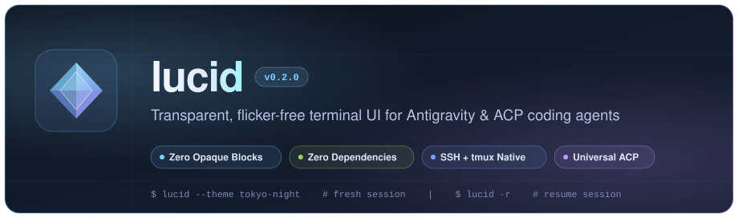

<p align="center">
  
</p>

<p align="center">
  <strong>English</strong> · <a href="README.zh-CN.md">简体中文</a> · <a href="docs/reference.md">Reference</a> · <a href="docs/tips.md">SSH, tmux &amp; Swarm</a>
</p>

A transparent-background, zero-dependency TUI for **Google Antigravity (`agy acp`)** and other [ACP](https://agentclientprotocol.com/) coding agents. Pure Node.js (`>= 20`).

<p align="center">
  
</p>

## Why

- **No opaque background blocks** — renders on your terminal's native background (`\x1b[49m`) across 5 foreground themes.
- **Built for SSH & `tmux`** — synchronized row-diff rendering, hardware scroll regions, OSC 52 drag-to-copy, and tmux-free background sessions (`lucid bg`).
- **Quiet tool timeline** — groups read-only steps into `• Explored` on the active turn and folds older turns into one-line summaries (`Ctrl+O` to expand).
- **Live Swarm & Subagent dock** — shows each worker's status, progress, and elapsed time below the composer; `Alt+[` / `Alt+]` inspects any agent live.

## Install

Requires **Node.js >= 20** and an ACP agent (`agy`, `gemini`, `opencode`, `goose`, `claude-code-acp`, `codex-acp`, etc.).

```bash
git clone https://github.com/Kagura-0001/lucid.git
cd lucid
npm link
```

## Quick Start

```bash
lucid                         # start with agy acp
lucid -r                      # resume a saved or live background session
lucid -c                      # continue the most recent session in cwd
lucid bg "run tests and fix"  # run detached in the background
lucid --theme tokyo-night     # pick a palette
lucid --agent opencode        # use another ACP backend
```

## Docs

- [Reference](docs/reference.md) — CLI flags, keybindings, slash commands, permissions, ACP backends, and `config.json`.
- [SSH, tmux, Themes & Swarm](docs/tips.md) — theme gallery, `tmux` + OSC 52 setup, mouse scrolling, and how live Swarm/Subagent tracking works.

## License

[MIT](LICENSE)
