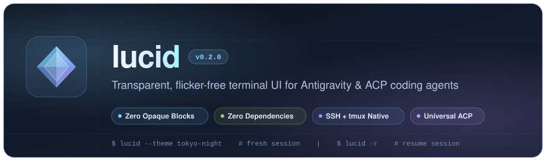
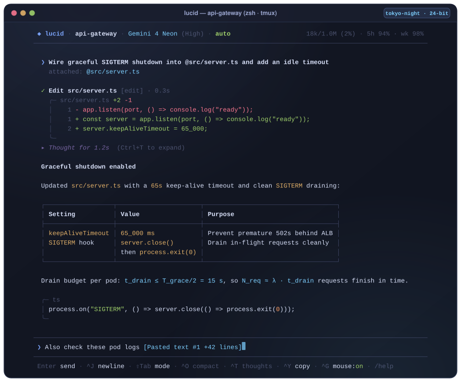
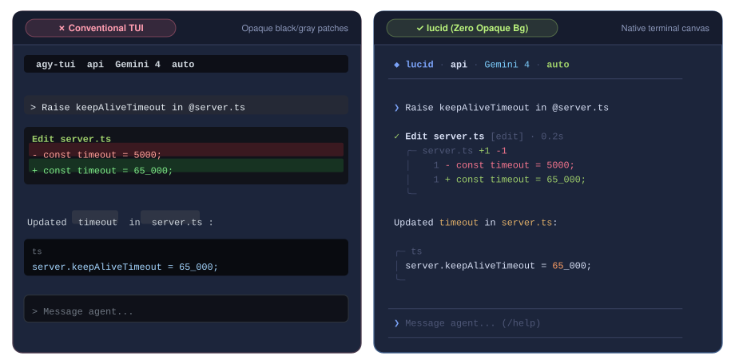
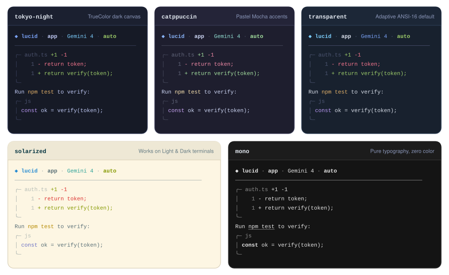
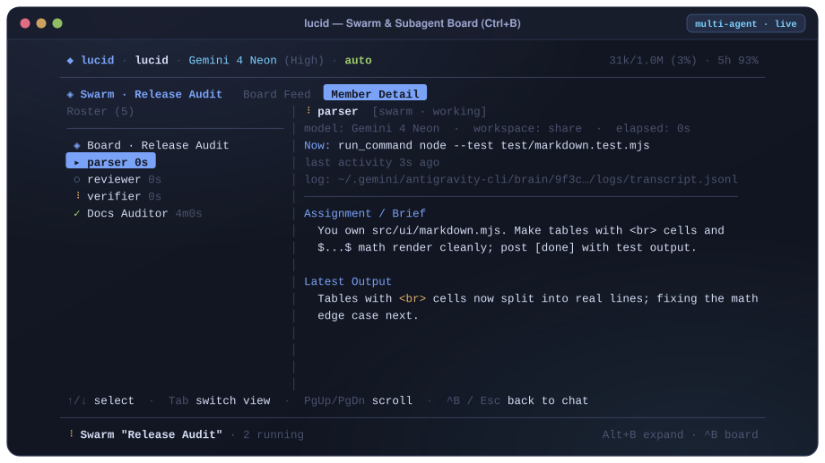
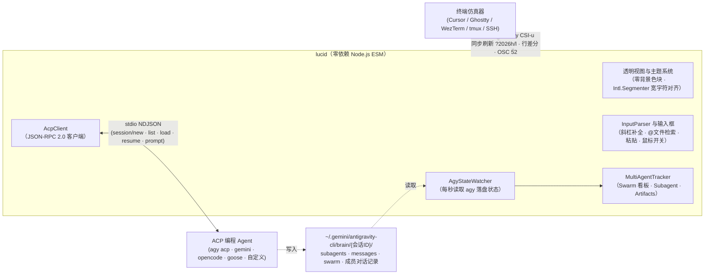

<p align="center">
  
</p>

<p align="center">
  = 20" />
  
  
  
  <a href="LICENSE"></a>
</p>

<p align="center">
  <a href="README.md">English</a> · <strong>简体中文</strong>
</p>

---

**lucid** 是一个专为 **Google Antigravity（`agy acp`）** 及所有 **Agent Client Protocol（ACP）** 编程 Agent 打造的透明背景、无闪烁、零依赖终端界面（TUI）。

大多数终端 Agent UI 会在消息、代码块、Diff 和输入框后面强行铺一层纯黑或深灰底块，在自定义终端配色、浅色主题、半透明窗口或 `tmux` 里显得非常割裂。**lucid** 彻底去掉了不透明背景色块（始终保留终端默认背景 `\x1b[49m`），仅用清晰的排版留白、细线边框和克制的前景色区分层级。

<p align="center">
  
</p>

---

## 核心特性

<p align="center">
  
</p>

| 特性 | 说明 |
| :--- | :--- |
| **零不透明底块** | 对话流、行内 `code`、代码块、Markdown 表格、Diff、弹窗和输入框全部透明贴合你的终端底色，并通过自动化测试校验全 5 套主题零背景色码泄露。 |
| **Remote SSH + `tmux` 深度适配** | DEC 同步输出（`?2026h`/`l`）+ 行级差分刷新，流式输出不闪烁；滚动时用终端硬件滚动区域只补发新露出的行（每帧数据量约减少 90%），每一行写出前都会清理控制字符，长命令、heredoc、超长路径不会把屏幕画花。 |
| **鼠标选中即复制** | 在对话区拖拽选中，松开即通过 OSC 52（自动兼容 `tmux` 透传）复制到本地剪贴板，有选区时 `Ctrl+C` 再复制一次；`Ctrl+Y` 复制最新整条回复；`Ctrl+G` 随时切回终端原生拖拽选中，滚轮照样能滚对话区。 |
| **原生支持 Antigravity (`agy`)** | 直连 `agy acp --stdio`，直接复用你的 Google 登录态、模型列表、思考强度（`thought_level`）、执行模式、权限审批弹窗、历史会话恢复（`/resume` / `-r` / `-c`）与只读 `/quota` 查询。 |
| **权限模式随手切** | 默认 `auto` 模式；`Shift+Tab` 可在会话内切到 `bypass`（自动批准所有工具权限，仅本次会话有效），也可以用 `--bypass` 启动整段全放行。 |
| **多 Agent Swarm 看板** | 输入框上方直接列出每个 Swarm Worker / Subagent 的名字、状态和正在执行的动作；`Ctrl+B`（`/board`）打开分栏看板看任务说明、输出和共享消息板。使用 agy 时状态读取自 agy 落盘的实时数据，后台 Subagent 跑完会及时显示 ✓。 |
| **公式与富 Markdown** | 行内 / 块级 LaTeX（`$...$`、`$$...$$`、`\(...\)`、`\[...\]`）渲染为 Unicode（下标、分数、希腊字母、运算符），表格单元格里的 `<br>` 会真正换行，`$5` 这类价格不会被误判成公式。 |
| **长粘贴自动折叠** | 粘贴超过 4 行或 300 字符时，输入框里折叠成 `[Pasted text #1 +11 lines]` 标签，一次 `Backspace` 整块删除，发送时自动展开成完整原文。 |
| **零外部运行时依赖** | 纯 Node.js（`>= 20`）ESM 实现，秒级启动；中日韩字符与 Emoji 按字形计算列宽，长文本换行耗时随长度线性增长，几万字的回复也不卡。 |

---

## 快速开始

### 环境要求

- **Node.js `>= 20.0.0`**
- 本地已安装任一支持 ACP 的编程 Agent，如 **Google Antigravity CLI（`agy`）**、**Gemini CLI**、**OpenCode**、**Goose**、**Claude Code (ACP)** 或 **Codex (ACP)**。

### 安装

```bash
git clone https://github.com/Kagura-0001/lucid.git
cd lucid

# 方式 A：通过 npm 全局链接
npm link

# 方式 B：直接软链到 ~/.local/bin
chmod +x ./bin/lucid.mjs
ln -sf "$(pwd)/bin/lucid.mjs" ~/.local/bin/lucid
```

### 启动使用

```bash
lucid                         # 在当前目录启动新的 Antigravity 会话
lucid -r                      # 交互式选择并恢复当前目录的历史会话
lucid -r <id-or-prefix>       # 通过完整会话 ID 或 >=4 位唯一前缀直接恢复
lucid -c                      # 直接续接当前目录最近一次对话
lucid --theme tokyo-night     # 使用 Tokyo Night 前景色（透明底色）
lucid --agent opencode        # 改用 OpenCode ACP 后端
lucid --cmd "gemini --experimental-acp"
```

---

## 内置 5 套透明主题

在界面里输入 `/theme` 随时切换，或启动时传入 `--theme <name>`（会自动保存到 `~/.config/lucid/config.json`）。无论深色、浅色还是磨砂半透明终端都能自然融入：

<p align="center">
  
</p>

| 主题名 | 风格特点 | 适用场景 |
| :--- | :--- | :--- |
| `transparent` *（默认）* | 自适应 ANSI-16 前景色 | 直接沿用你终端本身的 16 色方案，零配置融入 |
| `tokyo-night` | 清爽蓝青紫 TrueColor | 深色或半透明开发者终端 |
| `catppuccin` | 柔和 Catppuccin Mocha 色板 | 偏暖色调的暗色终端环境 |
| `solarized` | 均衡 Solarized 配色 | **浅色（Solarized Light）与深色终端皆宜** |
| `mono` | 纯黑白灰字重与下划线 | 极简、无彩色干扰的纯排版模式 |

---

## Swarm 看板、产物浏览与多模态附件

有 **Swarm Worker** 或 **Subagent** 在跑时，输入框上方会出现一行状态条，按名字列出每个成员的状态，正在干活的那个还会带上当前动作，例如：

```text
⠋ Swarm "parser rewrite" 2 working 1 waiting · ⠋ parser run_command cargo test  ◌ verifier  ✓ Tmp Lister · ^B board
```

按 **`Ctrl+B`**（或输入 `/board`）切入分栏视图：左侧是成员列表，右侧可看选中成员的任务说明、当前动作（`Now:`）、上次活动时间、最新输出和对话记录路径，或切到共享消息板。会话中生成的 Markdown 计划或报告会自动收集到 `/artifacts` 弹窗里供滚动阅读与一键复制。

> ACP 协议只传主对话的内容：`invoke_subagent` 在子代理刚启动时就报完成，子代理之后的进展和回复不会出现在 ACP 里。所以使用 agy 时，lucid 每秒读取一次 agy 写在本地的会话状态（`~/.gemini/antigravity-cli/brain/<会话ID>/.system_generated/` 下的 `subagents/`、`messages/`、`swarm/` 以及各成员的对话记录），文件没变化时几乎不耗时。数据目录不在默认位置时，可在配置里写 `"agyDataDir"`。

<p align="center">
  
</p>

**上下文与图片附件：**
- **`@path`**：输入 `@` 模糊检索工作区文件（遵循 `.gitignore`），作为 ACP `resource` 上下文块发给模型。
- **`Ctrl+V` / `/image <path>` / `@img.png` / 拖拽路径粘贴**：读取本地剪贴板图片或指定路径图片（支持 PNG / JPEG / WebP / GIF，最大 20 MB），以 ACP `image` 块发送；可用 `/unattach` 清空待发图片。

---

## 权限与执行模式

| 方式 | 效果 | 生效范围 |
| :--- | :--- | :--- |
| 默认 | 启动后自动切到 agent 的 `auto` 模式；用 `Shift+Tab` / `/mode` 换过的模式会记到配置里 | 一直有效 |
| `Shift+Tab` 切到 `bypass`（或 `/mode bypass`） | agent 用 `auto` 模式运行，lucid 自动批准所有工具权限请求，已经弹着的权限框也会直接批掉；顶栏显示红色 `bypass` | 只在本次 lucid 会话有效，不写入配置；再按 `Shift+Tab` 恢复询问 |
| `lucid --bypass`（`--yolo` / `--dangerously-skip-permissions`） | 给 `agy acp` 传 `--dangerously-skip-permissions`，由 agy 自己全部放行 | 整个进程；会话中途关不掉 |
| 配置 `"dangerouslySkipPermissions": true` | 等同于每次都带 `--bypass` 启动 | 长期 |

> bypass 下 agent 删文件、跑任意命令都不会再询问。会话内的 bypass 只能批准 agy 发来询问的操作，agy 因沙箱等原因直接拒绝、没有来问的操作，lucid 也绕不过去。

---

## 鼠标、复制与滚动

- **鼠标接管开启（默认）**：滚轮滚动对话区；拖拽选中对话文字，松开自动复制（OSC 52），选区跟着内容走，滚动或有新输出时不会错位。想用终端原生选择时按住 `Shift` 拖拽（iTerm2 为 `Option`）。
- **鼠标接管关闭（`Ctrl+G` / `--no-mouse`）**：拖拽交给终端原生处理，延迟最低；lucid 会开启终端的 alternate-scroll 模式，滚轮照样滚对话区。输入框为空时单个 `↑` / `↓` 也会滚动，翻历史输入用 `Ctrl+P` / `Ctrl+N`。
- **OSC 52 复制**需要终端支持：VS Code、Windows Terminal、kitty、WezTerm 可直接用；iTerm2 需打开“允许终端程序访问剪贴板”；`tmux` 里需 `set -g set-clipboard on`。
- 在 VS Code 终端里用触控板滚动时，VS Code 会先攒够一行的滑动量才发出滚轮事件，起步会略慢；可把 `terminal.integrated.mouseWheelScrollSensitivity` 调到 2～3。

---

## 支持的 ACP 后端

| 预设 (`-a`) | Agent | 启动命令 | 备注 |
| :--- | :--- | :--- | :--- |
| `agy` *（默认）* / `antigravity` | **Google Antigravity** | `agy acp --stdio` | 支持 `/quota`、`--sandbox`、`--add-dir`、`--dangerously-skip-permissions` |
| `gemini` | **Gemini CLI** | `gemini --experimental-acp` | 标准 ACP 会话与流式输出 |
| `opencode` | **OpenCode** | `opencode acp` | 标准 ACP 会话与流式输出 |
| `goose` | **Goose** | `goose acp` | 标准 ACP 会话与流式输出 |
| `claude` | **Claude Code (ACP)** | `claude-code-acp` | 标准 ACP 会话与流式输出 |
| `codex` | **Codex (ACP)** | `codex-acp` | 标准 ACP 会话与流式输出 |
| `--cmd "<command>"` | **任意自定义 ACP 服务** | 任意命令行 | 也支持写入 `~/.config/lucid/config.json` 的 `customAgents` |

---

## 架构概览



---

## 命令行参数与快捷键

### CLI 参数

| 参数 | 说明 |
| :--- | :--- |
| `-r, --resume [id]` | 打开历史会话选择器；传入完整 ID 或 `>=4` 位唯一前缀时直接恢复（支持 `--resume=<id>`） |
| `-c, --continue` | 自动恢复当前目录最近一次对话 |
| `-s, --session <id>` | 按指定会话 ID 恢复（支持 `>=4` 位唯一前缀） |
| `-a, --agent <preset>` | 选择内置 ACP 后端（`agy`, `antigravity`, `gemini`, `opencode`, `goose`, `claude`, `codex`） |
| `--cmd "<command>"` | 启动自定义 ACP stdio 命令 |
| `-t, --theme <name>` | 指定透明主题（`transparent`, `tokyo-night`, `catppuccin`, `solarized`, `mono`） |
| `-m, --model <id>` | 启动后切换指定模型 |
| `--mode <mode>` | 启动后切换执行模式（`default`, `accept-edits`, `auto`, `plan`）；不传时使用配置里的 `mode`（默认 `auto`） |
| `--cwd <dir>` | 指定工作区目录（默认为当前目录） |
| `--add-dir <dir>` | 追加额外工作区目录（可重复传入，适用于 `agy`） |
| `--sandbox` | 向 `agy acp` 传递 `--sandbox` |
| `--dangerously-skip-permissions` / `--bypass` / `--yolo` | 向 `agy acp` 传递 `--dangerously-skip-permissions`（也可在配置里写 `"dangerouslySkipPermissions": true`） |
| `--no-mouse` | 启动时禁用鼠标滚轮捕获，始终保持原生拖拽选中 |
| `-v, --version` / `-h, --help` | 查看版本号或帮助信息 |

### 快捷键与斜杠命令

| 快捷键 / 命令 | 功能 |
| :--- | :--- |
| `Enter` | 发送消息（生成过程中输入内容回车可直接引导当前轮次） |
| `Ctrl+J` / `Shift+Enter` / `Alt+Enter` / `\`+`Enter` | 输入框换行 |
| `Esc` | 关闭弹窗 / 中断当前生成 / 回到对话底部 |
| `Shift+Tab` | 循环切换执行模式（`default` / `accept-edits` / `auto` / `plan` / `bypass`）。`bypass` = auto 模式 + 自动批准所有工具权限，只在本次 lucid 会话有效，不写入配置 |
| `Ctrl+B` / `/board` | 打开/关闭 Swarm 与 Subagent 多栏看板 |
| `Ctrl+O` / `/expand` | 切换工具输出与 Diff 展开/折叠 |
| `Ctrl+T` / `/thoughts` | 切换思考过程（Thought）完整显示/折叠 |
| 鼠标拖拽 | 在对话区选中文字，松开即通过 OSC 52 复制；有选区时 `Ctrl+C` 再复制一次，`Esc` 取消选区 |
| `Ctrl+Y` / `/copy` | 通过 OSC 52 复制最新一条助手回复到本地剪贴板 |
| `Ctrl+G` / `/mouse` | 切换鼠标滚轮捕获（关闭后可用终端原生拖拽复制，滚轮仍通过 alternate-scroll 滚动对话区） |
| `Ctrl+P` / `Ctrl+N` | 上一条 / 下一条历史输入 |
| `Ctrl+V` / `/image <path>` / `/paste-image` | 附带剪贴板或本地图片（支持 `@img.png` 与路径拖放；`/unattach` 清空） |
| 粘贴长文本 | 超过 4 行或 300 字符时折叠成 `[Pasted text #N +K lines]` 标签；`Backspace` 整块删除；`Ctrl+O` 展开后可在时间线查看原文 |
| `Ctrl+L` | 强制全屏重绘 |
| `PgUp` / `PgDn` / `Alt+↑` / `Alt+↓` / 滚轮 | 滚动浏览历史消息 |
| `Ctrl+D` / 连按两次 `Ctrl+C` / `/quit` | 安全退出（输入非空或生成中单按 `Ctrl+C` 为清空/中断） |
| `/resume [id\|filter]` (`/sessions`) | 打开历史会话选择器，或按 ID/关键词过滤并恢复 |
| `/new` | 开启新对话 |
| `/model` · `/effort` · `/mode [name]` | 交互式切换模型、思考档位与执行模式（`/mode bypass` 进入会话内全放行） |
| `/artifacts` | 浏览并阅读当前会话记录到的 Markdown 产物 |
| `/theme [name]` | 切换透明主题 |
| `/quota` | 查询 Antigravity 额度（只读，不消耗对话配额） |
| `/clear` · `/help` | 清屏当前时间线（保留会话） · 打开快捷键说明 |
| `@path` | 模糊搜索并附加工作区文件 |

---

## 配置文件与 `tmux` 推荐设置

用户偏好默认保存于 `~/.config/lucid/config.json`（优先读取 `XDG_CONFIG_HOME`），也可以在里面注册自定义 ACP Agent：

```json
{
  "theme": "tokyo-night",
  "agent": "agy",
  "mode": "auto",
  "dangerouslySkipPermissions": false,
  "mouseCapture": true,
  "thoughtMode": "fold",
  "expandTools": false,
  "customAgents": {
    "my-agent": {
      "name": "My ACP Agent",
      "command": "my-agent-bin",
      "args": ["acp", "--stdio"],
      "supportsQuotaCli": false
    }
  }
}
```

可选项：`"agyDataDir"` 指定 agy 数据目录（默认 `~/.gemini/antigravity-cli`，或启动参数里的 `--app-data-dir`）；`thoughtMode` 取 `fold` / `expanded` / `hidden`。

在 Remote SSH + `tmux` 下获得完整 **24-bit TrueColor** 和 **OSC 52 剪贴板复制**，推荐在 `~/.tmux.conf` 中开启：

```tmux
set -g default-terminal "tmux-256color"
set -as terminal-features ",xterm*:RGB"
set -g set-clipboard on
set -g allow-passthrough on
```

---

## 开发与测试

```bash
npm test          # 运行完整单元测试与 Mock ACP 生命周期测试
npm run preview   # 验证全 5 套主题输出零不透明背景色码、零宽度溢出
npm run assets    # 直接调用 lucid 渲染引擎重新生成 README 中的 SVG 展示图
```

## 开源协议

[MIT](LICENSE)
