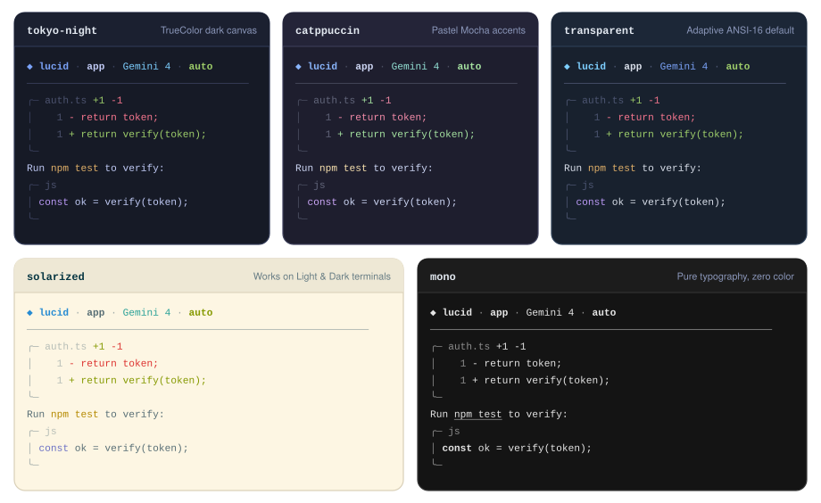
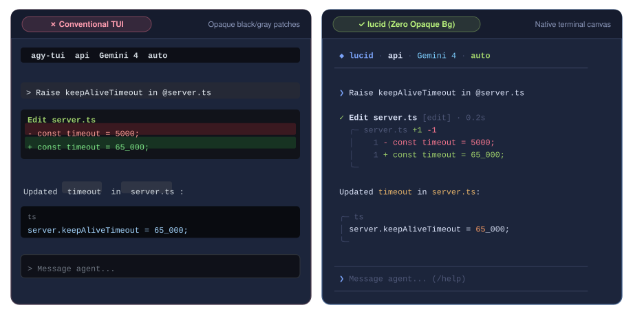
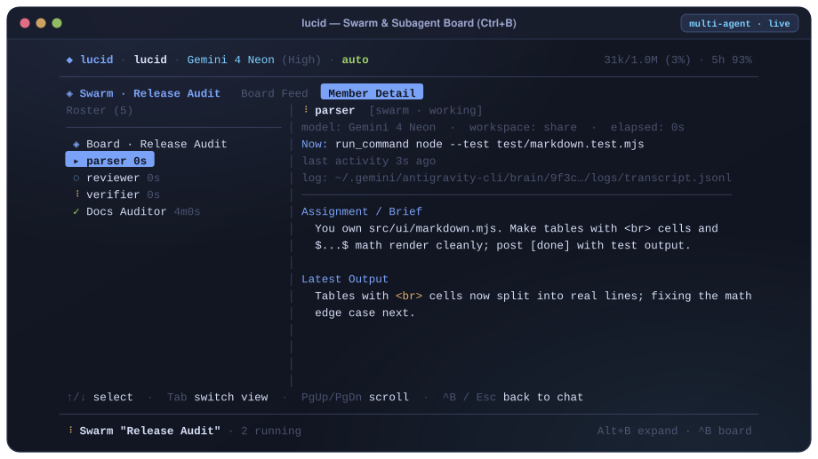

# SSH, tmux, Themes & Swarm

## Themes

All five themes leave the terminal background untouched (`\x1b[49m`):

- `transparent` *(default)* — inherits your terminal's 16-color palette
- `tokyo-night` — blue/cyan/violet TrueColor accents for dark or translucent terminals
- `catppuccin` — soft Catppuccin Mocha foregrounds
- `solarized` — works on both Solarized Light and Solarized Dark
- `mono` — bold, dim, and underline only

<p align="center">
  
</p>

<p align="center">
  
</p>

## `tmux`, Mouse & Clipboard (OSC 52)

For 24-bit TrueColor and OSC 52 clipboard copy inside `tmux` over SSH, add to `~/.tmux.conf`:

```tmux
set -g default-terminal "tmux-256color"
set -as terminal-features ",xterm*:RGB"
set -g set-clipboard on
set -g allow-passthrough on
set -g mouse on
```

- **Mouse capture ON (default):** wheel scrolls the conversation; drag-select copies on release via OSC 52 (anchored to content so streaming output doesn't shift your selection). Hold `Shift` (iTerm2: `Option`) for native terminal selection. Inside `tmux`, enable `set -g mouse on` so wheel events reach lucid instead of arriving as `↑`/`↓` arrow keys.
- **Mouse capture OFF (`Ctrl+G` / `--no-mouse`):** native terminal drag-select with zero latency; Alternate Scroll (`?1007l`) stays disabled so wheel scrolling never hijacks `↑`/`↓` prompt history. Use `PgUp`/`PgDn` or `Alt+↑`/`Alt+↓` to scroll, or toggle `Ctrl+G` back ON for wheel scrolling.
- **Terminal notes:** VS Code, Windows Terminal, kitty, and WezTerm support OSC 52 out of the box; iTerm2 needs *"Applications in terminal may access clipboard"*. In VS Code's integrated terminal, setting `terminal.integrated.mouseWheelScrollSensitivity` to `2`–`3` makes trackpad scrolling snappier.

## Tool Timeline & Long Pastes

- **Active turn:** read-only calls (`read_file`, `ls`, `rg`, `read_board`, `swarm status`, etc.) are grouped into `• Explored`; commands, edits, and board posts are shown cleanly without raw `[kind]` tags or `Created At:` metadata, and non-zero exit codes are highlighted with their error lines.
- **Older turns:** automatically fold into a single-line summary (`▸ Worked for … · N steps · ^O expand`), keeping any failed command or edited file visible underneath. Press `Ctrl+O` anytime to expand everything.
- **Long pastes:** pastes over 4 lines or 300 characters collapse into `[Pasted text #1 +N lines]` chips in the composer, deleted with one `Backspace` and expanded on send.

## Live Swarm & Subagent Tracking

When Swarm workers or Subagents are active, lucid shows a multi-line progress dock below the composer with overall `plan.json` task progress, per-member status, current action, and elapsed time:

- Press **`Alt+[`** / **`Alt+]`** (or `Shift+←` / `Shift+→` with an empty composer) to inspect any member's live step stream directly in the main viewport; press **`Esc`** to return to the main conversation.
- Press **`Alt+B`** (or `/dock`) to fold/expand the bottom dock.
- Press **`Ctrl+B`** (or `/board`) for the split-pane board with plan overview, recent steps, briefs, outputs, and the shared message board.

<p align="center">
  
</p>

> **How it works with `agy`:** ACP only streams the main conversation (`invoke_subagent` completes immediately on launch). When connected to `agy`, lucid polls `agy`'s local session files once per second (`~/.gemini/antigravity-cli/brain/<session>/.system_generated/` — `subagents/`, `messages/`, `swarm/`, and member `transcript.jsonl` files), skipping unchanged files. Set `"agyDataDir"` in `config.json` if your `agy` data lives elsewhere.
